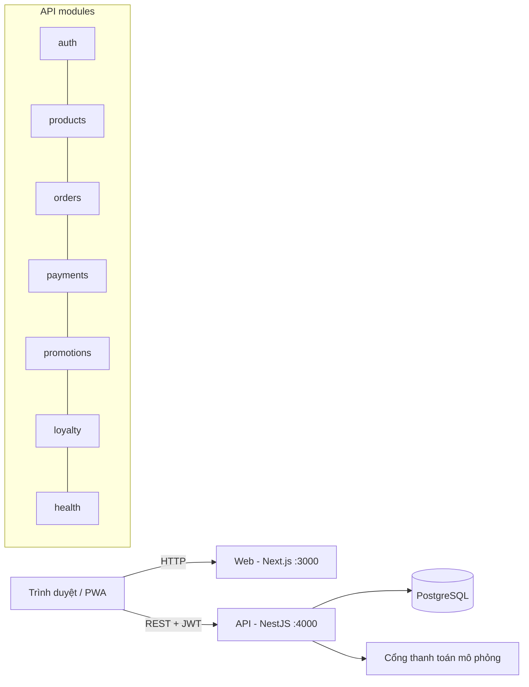
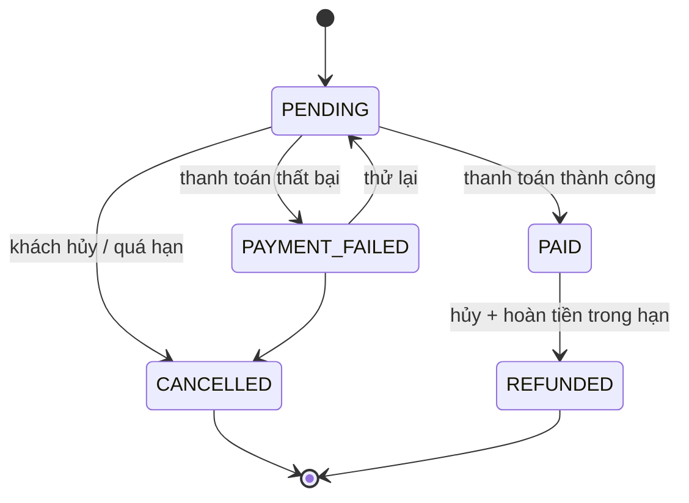
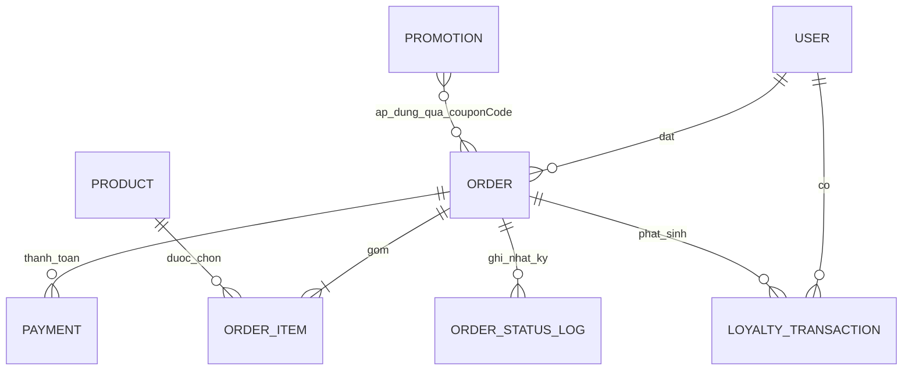

# BrewLite – Ứng dụng đặt cà phê không dùng tiền mặt

BrewLite là ứng dụng web mobile-first (hướng PWA) giúp khách hàng xem menu, tùy chọn đồ uống, đặt đơn và thanh toán không dùng tiền mặt ngay trên điện thoại, sau đó theo dõi lịch sử đơn. Dự án làm theo quy trình Agile Scrum.

MVP đi từ **chọn sản phẩm → giỏ hàng → thanh toán → xác nhận đơn**, kèm hủy đơn và hoàn tiền trong thời hạn cho phép.

 
## Tính năng chính

| Nhóm | Nội dung |
|---|---|
| Xác thực | Đăng ký, đăng nhập, đăng xuất, JWT, xem hồ sơ và điểm thưởng (chỉ có vai trò khách hàng) |
| Menu | Danh sách đồ uống, tìm kiếm, lọc danh mục, hiển thị còn hàng / hết hàng |
| Tùy chọn đồ uống | Size S/M/L, topping, mức đường, mức đá, số lượng; giá tính theo tùy chọn |
| Giỏ hàng | Thêm / sửa / xóa món, lưu khi tải lại trang, ghi chú đơn |
| Khuyến mãi & điểm | Áp mã giảm giá, dùng điểm thưởng, tích điểm sau khi thanh toán |
| Đặt đơn | Tạo đơn `PENDING`, giữ tồn kho, **giá luôn được tính lại ở server** |
| Thanh toán | Ví / Thẻ (cổng mô phỏng), chống trừ tiền hai lần bằng `Idempotency-Key`, thử lại khi thất bại |
| Đơn hàng | Xác nhận, lịch sử (lọc, phân trang), chi tiết kèm timeline, hủy đơn, hủy + hoàn tiền trong hạn |
| Vận hành | Docker Compose, health check, migration + seed, CI trên GitHub Actions |

## Công nghệ

| Lớp | Công nghệ |
|---|---|
| Frontend (`apps/web`) | Next.js (App Router), React, TypeScript, Tailwind CSS, Zustand |
| Backend (`apps/api`) | NestJS, Passport JWT, class-validator, bcryptjs |
| Cơ sở dữ liệu | PostgreSQL 16, Prisma (migration + seed) |
| Kiểm thử | Postman, `node:test` (E2E) |
| Hạ tầng | Docker, Docker Compose, GitHub Actions; kế hoạch triển khai: Render + GHCR |

## Kiến trúc

Monorepo, backend theo kiểu **modular monolith** (mỗi domain một module NestJS). Trình duyệt gọi API trực tiếp, nên API bật CORS theo `FRONTEND_URL`.



Các module trong `apps/api/src`: `auth`, `products`, `orders`, `payments`, `promotions`, `loyalty`, `health`, `prisma`, `common`.

## Cấu trúc repository

```
brewlite/
|-- apps/
|   |-- web/                    # Next.js mobile-first/PWA
|   `-- api/                    # NestJS + Prisma
|-- docs/
|   |-- requirements/           # Bối cảnh, stakeholder, phạm vi, yêu cầu
|   |-- diagrams/               # Sequence diagram (.puml + .svg)
|   |-- architecture/adr/       # 11 Architecture Decision Record
|   |-- traceability-matrix.md
|   `-- deployment.md
|-- tests/                      # E2E (smoke, đăng nhập)
|-- .github/workflows/          # CI/CD
|-- docker-compose.yml
|-- .env.example
`-- README.md
```

| Thư mục | Nội dung |
|---|---|
| `apps/api/` | NestJS + Prisma + PostgreSQL (REST API, JWT) — xem `apps/api/README.md` |
| `apps/web/` | Next.js + TailwindCSS + Zustand — xem `apps/web/README.md` |
| `docs/` | Tài liệu: yêu cầu, sơ đồ, kiến trúc (ADR), ma trận truy vết, triển khai |
| `tests/` | Test chạy trên hệ thống thật — xem `tests/README.md` |
| `docker-compose.yml` | Chạy cả 3: frontend, backend, DB |

## Chạy bằng Docker

```bash
docker compose up --build
```

- Frontend: http://localhost:3000
- Backend: http://localhost:4000 (health check: http://localhost:4000/health)
- PostgreSQL: `localhost:5433` (user / mật khẩu / database đều là `brewlite`). Cổng 5433 trên máy host để không đụng PostgreSQL cài sẵn ở 5432; bên trong Docker backend vẫn nối tới `db:5432`.
- Lần đầu backend tự chạy migration (`prisma migrate deploy`) rồi nạp dữ liệu mẫu.
- Nếu trước đây đã chạy bản dùng `db push` hoặc mật khẩu DB đã đổi, chạy `docker compose down -v` một lần để tạo lại database sạch (**xóa toàn bộ dữ liệu trong DB**).
- Muốn đổi mật khẩu DB, `JWT_SECRET`... thì sao chép `.env.example` thành `.env` rồi sửa (không có `.env` thì dùng giá trị mặc định).

## Chạy thủ công

```bash
# 1) Database (cổng 5433 trên máy host)
docker compose up -d db

# 2) Backend
cd apps/api
cp .env.example .env            # PowerShell: Copy-Item .env.example .env
npm install
npx prisma generate
npx prisma migrate deploy
npm run seed
npm run start:dev               # http://localhost:4000

# 3) Frontend (terminal khác)
cd apps/web
cp .env.example .env.local      # PowerShell: Copy-Item .env.example .env.local
npm install
npm run dev                     # http://localhost:3000

# 4) Prisma Studio (tùy chọn, chạy trong apps/api)
npx prisma studio               # http://localhost:5555
```

Dán từng lệnh một vào terminal, không dán lệnh vào file `.env`.

## Biến môi trường

Chỉ commit các file `.env.example`, không commit giá trị thật.

| Biến | Dịch vụ | Mặc định (dev) | Ý nghĩa |
|---|---|---|---|
| `POSTGRES_USER` / `POSTGRES_PASSWORD` / `POSTGRES_DB` | db | `brewlite` | Tài khoản và tên database |
| `DATABASE_URL` | api | – | Chuỗi kết nối PostgreSQL |
| `JWT_SECRET` | api | chuỗi mẫu | Khóa ký JWT, **phải đổi khi triển khai thật** |
| `JWT_EXPIRES_IN` | api | `7d` | Thời hạn token |
| `PORT` | api | `4000` | Cổng API |
| `FRONTEND_URL` | api | `http://localhost:3000` | Origin cho CORS (nhiều origin cách nhau dấu phẩy) |
| `ORDER_EXPIRE_MINUTES` | api | `15` | Đơn chưa thanh toán quá hạn thì tự hủy |
| `REFUND_WINDOW_MINUTES` | api | `5` | Thời hạn tự hủy + hoàn tiền đơn đã thanh toán |
| `MOCK_PAYMENT_ALLOW_FAILURE` | api | `true` | Cho phép ép thanh toán mô phỏng thất bại (chỉ để demo) |
| `NEXT_PUBLIC_API_URL` | web | `http://localhost:4000` | Địa chỉ API, nhúng vào bundle lúc build |
| `NEXT_PUBLIC_ALLOW_MOCK_FAILURE` | web | `true` | Hiện checkbox "Chế độ demo" ở trang thanh toán |

## Tài khoản & mã demo

| | |
|---|---|
| Khách hàng | `demo@brewlite.vn` / `Demo1234` (120 điểm) |
| Mã khuyến mãi | `CHAO10`, `GIAM15K`, `COMBO20` |

MVP chỉ có vai trò khách hàng. Trạng thái đơn:

- Thanh toán thành công → `PAID`.
- Khách có thể **hủy và được hoàn tiền** (`REFUNDED`) trong `REFUND_WINDOW_MINUTES` phút (mặc định 5) kể từ lúc thanh toán. Hoàn tiền trả lại tồn kho, mã giảm giá, điểm đã dùng và thu hồi điểm đã cộng.
- Đơn chưa thanh toán quá 15 phút (`ORDER_EXPIRE_MINUTES`) tự hủy.

## Nghiệp vụ chính

### Luồng đặt hàng

1. Khách chọn món → giỏ hàng lưu ở client (Zustand + localStorage). Giá ở client chỉ để tham khảo.
2. `POST /orders` → server tính lại giá, kiểm tra và giữ tồn kho, tạo đơn `PENDING`.
3. `POST /payments` kèm header `Idempotency-Key` → thành công thì đơn `PAID` và cộng điểm; thất bại thì `PAYMENT_FAILED`, khách thử lại hoặc hủy.
4. Xem đơn ở `/orders`, `/orders/detail?id=…`.

### Máy trạng thái đơn hàng



Chuyển trạng thái sai trả HTTP `409`. Cài đặt: `apps/api/src/orders/order-state-machine.ts`.

### Quy tắc giá và điểm thưởng

| Quy tắc | Giá trị |
|---|---|
| Phụ phí size | S: +0đ · M: +6.000đ · L: +12.000đ |
| Giá một ly | giá gốc + phụ phí size + tổng giá topping |
| Mức đường | `0%`, `30%`, `50%`, `70%`, `100%` |
| Mức đá | `Không đá`, `Ít đá`, `Đá bình thường` |
| Dùng điểm | 1 điểm = 500đ |
| Tích điểm | +1 điểm cho mỗi 10.000đ của tổng đơn sau giảm giá, cộng đúng một lần khi `PAID` |
| Khuyến mãi | `PERCENT` (có trần `maxDiscount`) hoặc `FIXED`; có đơn tối thiểu, thời hạn, giới hạn lượt dùng |

Tiền tệ là VND, số nguyên. Nguồn sự thật duy nhất: `apps/api/src/common/pricing.ts`.

### Các bảo đảm về độ đúng đắn

| Vấn đề | Cách xử lý |
|---|---|
| Trừ tiền hai lần | `Idempotency-Key` bắt buộc, ràng buộc unique trên `Payment.idempotencyKey`; gửi lại cùng key không gọi cổng lần hai |
| Bán quá tồn kho khi đặt đồng thời | Transaction + optimistic locking theo `version`, xử lý theo id tăng dần để tránh deadlock |
| Chuyển trạng thái đơn song song | Optimistic locking trên `Order.version` + nhật ký `OrderStatusLog` |
| Giao dịch kẹt `PROCESSING` | Quá 2 phút xem là thất bại |
| Cộng / hoàn điểm trùng | Sổ điểm có ràng buộc unique `(orderId, type)` |
| Đơn treo giữ tồn kho | Tự hủy sau `ORDER_EXPIRE_MINUTES` (`order-expiry.service.ts`) |
| Hoàn tiền | Giữ chỗ `Payment SUCCESS → REFUNDING` rồi mới gọi cổng; cổng lỗi trả 502 và đơn vẫn `PAID` để thử lại; quá hạn trả 422 |

## Mô hình dữ liệu



| Bảng | Vai trò |
|---|---|
| `User` | Tài khoản khách, `passwordHash` (bcrypt), `loyaltyPoints` |
| `Product`, `Topping` | Menu; `Product.stock` + `version` cho tồn kho |
| `Promotion` | Mã giảm giá (loại, giá trị, thời hạn, lượt dùng) |
| `Order`, `OrderItem` | Đơn và các dòng món (lưu snapshot tên, giá, topping) |
| `Payment` | Giao dịch thanh toán / hoàn tiền, khóa idempotency |
| `OrderStatusLog` | Nhật ký chuyển trạng thái để hiển thị timeline |
| `LoyaltyTransaction` | Sổ điểm: `EARN`, `REDEEM`, `REFUND`, `REVOKE` |

Schema đầy đủ: `apps/api/prisma/schema.prisma`; migration trong `apps/api/prisma/migrations/`.

## API tổng quan

Chi tiết tham số và ví dụ xem `apps/api/README.md`.

| Method | Đường dẫn | Mô tả | Auth |
|---|---|---|---|
| GET | `/health` | App + database còn sống (503 khi mất DB) | – |
| GET | `/products`, `/products/:id` | Menu, chi tiết và tùy chọn | – |
| POST | `/auth/register`, `/auth/login` | Đăng ký, đăng nhập (trả JWT) | – |
| GET | `/auth/me` | Hồ sơ + điểm thưởng | JWT |
| GET | `/promotions` | Khuyến mãi đang chạy | – |
| POST | `/promotions/validate` | Kiểm tra mã giảm giá | – |
| POST | `/orders` | Tạo đơn `PENDING` | JWT |
| GET | `/orders/me`, `/orders/:id` | Lịch sử và chi tiết đơn | JWT |
| POST | `/orders/:id/cancel` | Hủy đơn chưa thanh toán | JWT |
| POST | `/payments` | Thanh toán (bắt buộc `Idempotency-Key`) | JWT |
| POST | `/payments/refund` | Hủy + hoàn tiền đơn `PAID` trong hạn | JWT |

## Kiểm thử và CI

```bash
cd apps/api
npx prisma generate
npm test
```

| Loại | Vị trí | Nội dung |
|---|---|---|
| Unit | `apps/api/src/**/*.spec.ts` | State machine, idempotency thanh toán, tồn kho đồng thời, khuyến mãi, điểm thưởng, hoàn tiền |
| E2E smoke | `tests/e2e/smoke.mjs` | Đăng nhập → sản phẩm → tạo đơn → thanh toán (lặp key) → xem đơn |
| E2E đăng nhập | `tests/e2e/login.test.mjs` | Nhiều ca đầu vào `POST /auth/login` và kiểm tra token |

Chạy E2E (cần API + DB đã chạy và đã seed): `node tests/e2e/smoke.mjs`, `node --test tests/e2e/login.test.mjs`. Chi tiết trong `tests/README.md`.

**CI** (`.github/workflows/node.js.yml`) chạy khi mở PR hoặc push vào `main`:

| Job | Việc làm |
|---|---|
| `api` | `npm ci` → `prisma generate` → `npm test` → `npm run build` (Node 20 và 22) |
| `web` | `npm ci` → `npm run lint` → `npm run build` (Node 20 và 22) |
| `e2e` | PostgreSQL tạm → migrate → seed → chạy API thật → smoke + login test |

## Tài liệu dự án

| Tài liệu | Nội dung |
|---|---|
| `docs/requirements/context-and-scope.md` | Bối cảnh, stakeholder, phạm vi, giả định, ràng buộc, rủi ro |
| `docs/traceability-matrix.md` | Truy vết yêu cầu → thiết kế → code → test |
| `docs/deployment.md` | Kiến trúc triển khai, biến môi trường production, CI/CD, rollback, checklist bàn giao |
| `docs/diagrams/` | Sequence diagram luồng tạo đơn (01a) và thanh toán (01b) |
| `docs/architecture/adr/` | Quyết định kiến trúc (bảng dưới) |

| ADR | Quyết định |
|---|---|
| 001 | Monorepo |
| 002 | Modular monolith |
| 003 | PostgreSQL + Prisma migration |
| 004 | Xác thực JWT |
| 005 | Module cổng thanh toán |
| 006 | Idempotency key |
| 007 | Giữ chỗ tồn kho |
| 008 | Order state machine |
| 009 | Giỏ hàng phía client |
| 010 | Docker + GHCR + GitHub Actions |
| 011 | Nền tảng Render |

## Chức năng theo từng task

| # | Task | Vị trí |
|---|---|---|
| 1 | Khởi tạo dự án, README, `.env.example`, Git | thư mục gốc, `apps/api/`, `apps/web/` |
| 2 | API danh sách sản phẩm | `GET /products` |
| 3 | Trang Menu | `/menu` |
| 4 | Chi tiết & tùy chọn sản phẩm | `/menu/detail?id=...` |
| 5 | Giỏ hàng | `/cart`, `apps/web/store/cart.ts` |
| 6 | API tạo đơn | `POST /orders` |
| 7 | Đăng ký / Đăng nhập JWT | `/auth/*`, `/login`, `/register` |
| 8 | Thanh toán không tiền mặt (mock) | `POST /payments`, `POST /payments/refund`, `/checkout` |
| 9 | Xác nhận, lịch sử đơn, bàn giao | `/orders/*`, `GET /orders/me`, `docker-compose.yml` |
| 10 | Nghiệp vụ backend (state machine, idempotent, tồn kho, khuyến mãi/điểm, hoàn tiền) | `apps/api/src/orders`, `payments`, `promotions`, `loyalty` + test `npm test` |

## Lỗi thường gặp

| Triệu chứng | Nguyên nhân và cách xử lý |
|---|---|
| `P1000 Authentication failed` khi `migrate deploy` / `seed` | Sai user/mật khẩu hoặc `localhost:5432` đang trỏ tới Postgres khác. Dùng `DATABASE_URL` cổng **5433** của container; nếu volume cũ có mật khẩu khác thì `docker compose down -v` rồi `docker compose up -d db`. |
| `P1012 the URL must start with postgresql://` | `DATABASE_URL` trong `apps/api/.env` bị dính ký tự lạ (ví dụ lệnh dán nhầm vào file). Mở file và sửa lại đúng một dòng. |
| Prisma Studio mở được nhưng không có bảng / "Unable to run script" | Migration chưa chạy hoặc DB chưa kết nối được. Chạy `npx prisma migrate deploy` trước. |
| Web báo "Không thể kết nối tới máy chủ" (`ERR_CONNECTION_REFUSED`) | Backend chưa chạy ở cổng 4000. Chạy `npm run start:dev` trong `apps/api` (hoặc `docker compose up -d --build backend`). |
| TypeScript báo thiếu `REFUNDED` / `REVOKE` | Chạy `npx prisma migrate deploy` rồi `npx prisma generate` trong `apps/api`. |

 

Danh sách khoảng trống chi tiết nằm ở mục 6 của `docs/traceability-matrix.md`.

> Tài khoản demo có mật khẩu công khai và `MOCK_PAYMENT_ALLOW_FAILURE=true` chỉ dành cho demo.
