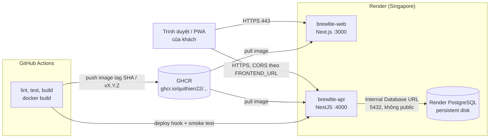

# Triển khai BrewLite (deployment.md)

Tài liệu này đáp ứng Task 3.2 (deployment), Task 5.3 (CI/CD) và Task 5.4 (bàn giao) của Assignment 2.
Nền tảng theo [ADR-011](architecture/adr/011-render-platform.md): **Render (Singapore)** + **GitHub Container Registry (GHCR)** + **GitHub Actions**.

> **Quy ước điền:** chỗ có `<...>` là thông tin nhóm phải điền sau khi triển khai thật. Cột "Trạng thái" ghi trung thực: ✅ đã có trong repo, ⬜ chưa làm. Cập nhật khi hoàn thành.

## 1. URL bàn giao

| Thành phần | URL | Trạng thái |
|---|---|---|
| Frontend (HTTPS) | `https://<brewlite-web>.onrender.com` | ⬜ |
| API | `https://<brewlite-api>.onrender.com` | ⬜ |
| Health check | `https://<brewlite-api>.onrender.com/health` → `{"status":"ok","database":"up",...}` | ⬜ |
| Repository | `https://github.com/quithien22/brewlite-` | ✅ |
| Release | `https://github.com/quithien22/brewlite-/releases/tag/v<X.Y.Z>` | ⬜ |
| Video demo | `<link>` | ⬜ |

Tài khoản demo cho người chấm: `demo@brewlite.vn` / `Demo1234`. Mã khuyến mãi: `CHAO10`, `GIAM15K`, `COMBO20`.

> Gói miễn phí của Render có thể "ngủ đông": lần gọi đầu có thể chậm 30–60 giây. Mở URL trước giờ chấm để đánh thức dịch vụ.

## 2. Kiến trúc triển khai



Trình duyệt gọi API trực tiếp (không qua proxy), nên API phải bật CORS đúng origin của web (`FRONTEND_URL`).

> Task 3.2 yêu cầu có **sơ đồ UML deployment** trong `docs/diagrams/`. Sơ đồ Mermaid ở trên chỉ là bản nháp; cần vẽ UML chính thức (`deployment-production.puml` + `.svg`) khớp với bảng dưới đây. ⬜

### Truy vết thành phần → kiến trúc → mã nguồn

| Thành phần triển khai | Thành phần kiến trúc (C4 mức 2) | Mã nguồn / cấu hình |
|---|---|---|
| Web Service `brewlite-web` | Web App | `apps/web`, `apps/web/Dockerfile` |
| Web Service `brewlite-api` | API (kèm module payments, cổng thanh toán mô phỏng) | `apps/api`, `apps/api/Dockerfile` |
| Render PostgreSQL | PostgreSQL | `apps/api/prisma` (schema, migrations, seed) |
| GHCR | Kho image (ADR-010) | `.github/workflows/` |
| GitHub Actions | CI/CD (NFR-15) | `.github/workflows/node.js.yml` (CI) ✅; workflow CD ⬜ |
| `GET /health` | Module health (NFR-17) | `apps/api/src/health` ✅ |
| Biến môi trường / secret | Cấu hình (NFR-07) | `.env.example`, Render Environment, GitHub Secrets |

### Ranh giới môi trường

| Môi trường | Cách chạy | Cấu hình |
|---|---|---|
| Local | `docker compose up --build` (web :3000, api :4000, db cổng host 5433) | `.env` không commit; không có `.env` thì dùng mặc định trong `docker-compose.yml` |
| CI | GitHub Actions: PR chạy install → lint → test → build, kèm job `e2e` với Postgres tạm | giá trị test, không phải secret thật |
| Production | Render, HTTPS do Render xử lý | Render Environment + GitHub Secrets |

## 3. Biến môi trường production 

Chỉ commit `.env.example`. **Không** commit giá trị thật.

| Biến | Dịch vụ | Production | Nơi đặt |
|---|---|---|---|
| `DATABASE_URL` | api | **Internal Database URL** của Render PostgreSQL | Render Environment |
| `JWT_SECRET` | api | chuỗi ngẫu nhiên dài, ví dụ `openssl rand -base64 48`; **không dùng giá trị mặc định** | Render Environment |
| `JWT_EXPIRES_IN` | api | `7d` hoặc ngắn hơn | Render Environment |
| `FRONTEND_URL` | api | URL HTTPS của web (CORS) | Render Environment |
| `PORT` | api | `4000` | Render Environment |
| `ORDER_EXPIRE_MINUTES`, `REFUND_WINDOW_MINUTES` | api | `15`, `5` | Render Environment |
| `MOCK_PAYMENT_ALLOW_FAILURE` | api | `true` nếu muốn demo thanh toán lỗi trên production, ngược lại `false` | Render Environment |
| `NEXT_PUBLIC_API_URL` | web | URL HTTPS của API. **Nhúng vào bundle lúc build** nên phải là build arg, đổi giá trị thì phải build lại image | build arg trong CI |
| `NEXT_PUBLIC_ALLOW_MOCK_FAILURE` | web | khớp với `MOCK_PAYMENT_ALLOW_FAILURE` | build arg trong CI |

GitHub Secrets / Variables cho pipeline CD (đặt trong Settings → Secrets and variables → Actions):

| Tên | Loại | Dùng cho |
|---|---|---|
| `GITHUB_TOKEN` | có sẵn | push image lên GHCR |
| `RENDER_DEPLOY_HOOK_API`, `RENDER_DEPLOY_HOOK_WEB` | Secret | gọi deploy hook của Render |
| `PROD_API_URL` | Variable | smoke test và `NEXT_PUBLIC_API_URL` |

**Quy tắc bảo mật:** không `echo` secret trong workflow; không in biến môi trường; không bật `set -x` ở bước dùng secret; `.env` luôn nằm trong `.gitignore` và `.dockerignore`.

## 4. Pipeline CI/CD

### CI (đã có: `.github/workflows/node.js.yml` ✅)
Chạy khi mở PR hoặc push vào `main`: `api` (generate → test → build, Node 20 và 22), `web` (lint → build), `e2e` (Postgres + migrate + seed + `tests/e2e`).
Bắt buộc bật **branch protection** cho `main`, đặt `api`, `web`, `e2e` làm required status check để PR không merge được khi lỗi. ⬜

### CD (cần tạo: `.github/workflows/cd.yml` ⬜)
Kích hoạt khi push tag `v*.*.*` (hoặc merge vào `main`):

```
Lint + Test → Build Docker image → Push GHCR → Deploy → Migrate → Smoke test
```

1. **Quality gate:** lại chạy lint, test, build.
2. **Build image** cho `api` và `web`, gắn tag bằng commit SHA và `vX.Y.Z` (không dùng `:latest` làm nguồn rollback). Image `web` build với `--build-arg NEXT_PUBLIC_API_URL=...`.
3. **Push** lên `ghcr.io/quithien22/brewlite-api` và `ghcr.io/quithien22/brewlite-web`.
4. **Deploy:** gọi deploy hook của Render (secret của CI).
5. **Migration:** `npx prisma migrate deploy` chạy khi container API khởi động (xem `apps/api/Dockerfile`). Lệnh này chỉ áp dụng migration đã có, không xóa dữ liệu. Không dùng `prisma db push` hay `migrate reset` ở production.
6. **Smoke test:** chờ `GET {API}/health` trả 200 (thử lại tối đa ~60 giây), rồi chạy `GET {API}/products` và tùy chọn `node tests/e2e/smoke.mjs` với `API_URL` production.
7. **Thất bại:** pipeline dừng, đánh dấu đỏ, và người vận hành thực hiện rollback (mục 6).

> Hiện repo còn workflow `nextjs.yml` deploy web lên **GitHub Pages**, trong khi ADR-011 chọn Render. Cần chọn một cách cho web và đồng bộ. Nếu bỏ Pages, xóa `nextjs.yml` và nhánh `production`. ⬜

## 5. Hướng dẫn triển khai thủ công lần đầu (Render)

1. **Database:** tạo Render PostgreSQL (region Singapore). Lấy **Internal Database URL**. Không bật truy cập ngoài (không thêm IP vào danh sách cho phép từ Internet).
2. **API:** tạo Web Service từ image `ghcr.io/quithien22/brewlite-api:<tag>`, cổng 4000. Đặt biến môi trường ở mục 3. Health check path: `/health`.
3. **Web:** tạo Web Service từ image `ghcr.io/quithien22/brewlite-web:<tag>`, cổng 3000. (Image phải được build sau khi biết URL API.)
4. Cập nhật `FRONTEND_URL` của API thành URL web rồi redeploy API.
5. Kiểm tra theo mục 7.
6. Nếu GHCR để chế độ private, thêm registry credential vào Render, hoặc đặt package ở chế độ public.

## 6. Rollback

**Nguyên tắc:** image đã gắn tag bất biến nên rollback là deploy lại image của tag trước.

**Rollback ứng dụng (api hoặc web):**
1. Xác định tag ổn định gần nhất (ví dụ `v1.0.0` hoặc SHA) trong tab Releases hoặc GHCR.
2. Trong Render → dịch vụ → Settings, đổi image sang tag đó rồi Manual Deploy (hoặc dùng nút Rollback ở tab Events/Deploys nếu có).
3. Chạy lại smoke test (mục 7).

**Rollback database:** Prisma migration chỉ đi tới, không có "down". Vì vậy:
- Viết migration tương thích ngược (thêm cột, bảng mới; không xóa hoặc đổi tên cột trong cùng release với code dùng nó).
- Trước release có migration, tạo backup: `pg_dump "$EXTERNAL_DATABASE_URL" -Fc -f backup-<ngày>.dump` (dùng Render backup nếu gói có hỗ trợ).
- Chỉ khi migration làm hỏng dữ liệu mới khôi phục: `pg_restore --clean --if-exists -d "$DATABASE_URL" backup-<ngày>.dump`. Việc này **mất các thay đổi sau thời điểm backup**.

**Rollback do cấu hình sai:** sửa biến môi trường trong Render, redeploy. Riêng `NEXT_PUBLIC_*` phải build lại image web.

## 7. Kiểm tra sau triển khai (smoke test thủ công)

```bash
curl -fsS https://<api>/health            # 200, "database":"up"
curl -fsS https://<api>/products | head   # có danh sách sản phẩm
API_URL=https://<api> node tests/e2e/smoke.mjs
```

Trình duyệt: mở URL web (có ổ khóa HTTPS) → xem menu → đăng nhập tài khoản demo → đặt đơn → thanh toán → thấy màn hình xác nhận và đơn `PAID` trong lịch sử.

Kiểm tra bảo mật:
- `http://` của web chuyển sang `https://` hoặc bị từ chối.
- Không kết nối được trực tiếp tới cổng PostgreSQL từ Internet: `psql "postgresql://<user>@<host-ngoài>:5432/<db>"` phải thất bại (hoặc host nội bộ không phân giải được từ ngoài).
- Log của Render và log CI không chứa `JWT_SECRET`, mật khẩu DB hay token.

## 8. Vận hành

- **Log:** API ghi ra stdout (method, đường dẫn, status, thời gian; không ghi header hay body). Xem ở Render → Logs.
- **Health check:** `GET /health` trả 200 khi app và database sống, 503 khi mất kết nối database.
- **Backup:** `pg_dump` định kỳ hoặc backup của Render.
- **Seed trên production:** `CMD` của API chạy `prisma db seed` mỗi lần khởi động (idempotent). Seed tạo tài khoản demo mật khẩu công khai. Chỉ chấp nhận cho môi trường chấm điểm; nếu dùng thật thì tắt seed tài khoản demo.

## 9. Checklist bàn giao (Task 5.4)

- [ ] URL frontend production mở được qua HTTPS
- [ ] URL API và `/health` trả 200
- [ ] Database không public (đã thử kết nối từ ngoài và thất bại)
- [ ] Quét secret trên toàn lịch sử Git sạch (`gitleaks detect --source . --log-opts="--all"`)
- [ ] `JWT_SECRET` production khác giá trị mặc định
- [ ] Tag `vX.Y.Z` và release notes trên GitHub
- [ ] Pipeline CD chạy thành công một lần, kèm một lần smoke test thất bại làm minh chứng
- [ ] README có đủ chạy local, test, build, deploy, rollback (trỏ về tài liệu này)
- [ ] Video demo luồng end-to-end
- [ ] Sprint Review và Sprint Retrospective
- [ ] Giảng viên có quyền truy cập repository
