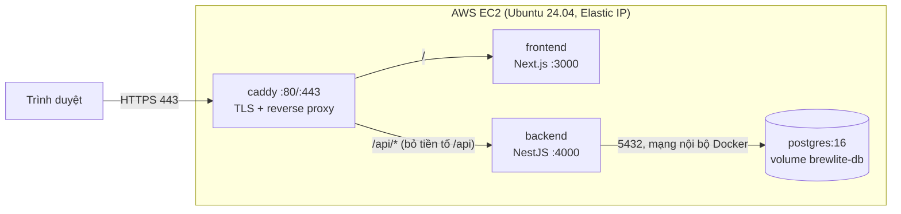

# Triển khai BrewLite lên AWS EC2 (deployment.md)

Tài liệu này hướng dẫn triển khai BrewLite (web Next.js + API NestJS + PostgreSQL) trên **một VPS AWS EC2** bằng **Docker Compose**, HTTPS tự động bằng **Caddy** (Let's Encrypt).

> Bản triển khai trên Render (theo [ADR-011](architecture/adr/011-render-platform.md)) được giữ lại ở [deployment-render.md](deployment-render.md). ADR-011 đã ghi VPS là phương án dự phòng, nên nên bổ sung `ADR-012-aws-ec2.md` ghi lại quyết định chuyển sang EC2.

> **Quy ước:** chỗ có `<...>` là giá trị bạn tự điền. Lệnh chạy trên **server** hay **máy local** được ghi rõ ở từng bước.

## 1. Tổng quan



Quyết định thiết kế:

- **Một domain, một chứng chỉ:** web ở `https://<domain>/`, API ở `https://<domain>/api/...`. Caddy bỏ tiền tố `/api` trước khi chuyển cho NestJS (API không có global prefix: `/health`, `/products`, ...). Trình duyệt gọi API cùng origin nên không vướng CORS.
- **Chỉ Caddy mở cổng ra Internet** (80, 443). `frontend`, `backend`, `db` không publish cổng; chúng chỉ thấy nhau trong mạng Docker.
- `NEXT_PUBLIC_API_URL` được **nhúng vào bundle lúc build** (build arg). Đổi domain thì phải build lại image `frontend`.
- Không dùng thẳng `docker-compose.yml` của repo cho production vì file đó mở cổng DB (5433), API (4000), web (3000) và có mật khẩu mặc định. Production dùng `docker-compose.prod.yml` ở mục 6.

## 2. Chuẩn bị

| Cần có | Ghi chú |
|---|---|
| Tài khoản AWS | Chọn region gần người dùng, ví dụ **ap-southeast-1 (Singapore)** |
| Key pair (.pem) | Tạo lúc khởi chạy instance, giữ an toàn, không commit |
| Domain (khuyến nghị) | Trỏ bản ghi **A** về Elastic IP. Chưa có domain thì dùng `<ip-viết-bằng-dấu-gạch>.sslip.io`, ví dụ IP `13.212.10.20` → `13-212-10-20.sslip.io` (xem lưu ý ở mục 5) |
| Quyền đọc repo | Repo `https://github.com/quithien22/brewlite-`. Nếu private, dùng deploy key hoặc Personal Access Token (read-only) |

## 3. Tạo EC2

Trong AWS Console → EC2 → **Launch instance**:

| Mục | Giá trị |
|---|---|
| AMI | Ubuntu Server 24.04 LTS |
| Loại máy | **t3.small (2 GB RAM)** trở lên. Tránh t3.micro (1 GB): build Next.js dễ bị hết bộ nhớ |
| Storage | gp3, **20–30 GB** (image Docker và build cache tốn dung lượng) |
| Key pair | chọn key pair đã tạo |
| Security group | xem bảng dưới |

**Security group (inbound):**

| Cổng | Nguồn | Mục đích |
|---|---|---|
| 22 (SSH) | **IP của bạn** (`My IP`), không để `0.0.0.0/0` | quản trị |
| 80 (HTTP) | `0.0.0.0/0` | Caddy xin chứng chỉ và chuyển sang HTTPS |
| 443 (HTTPS) | `0.0.0.0/0` | truy cập web và API |

**Không mở** 3000, 4000, 5432. Outbound để mặc định.

**Elastic IP:** EC2 → Elastic IPs → Allocate → Associate với instance. Nếu không làm, IP công khai đổi mỗi lần stop/start và domain/chứng chỉ sẽ hỏng.

Nếu có domain, tạo bản ghi `A`: `<domain>` → Elastic IP, rồi chờ DNS cập nhật (`nslookup <domain>`).

## 4. Chuẩn bị server

**Chạy trên máy local:**

```bash
chmod 400 brewlite-key.pem
ssh -i brewlite-key.pem ubuntu@<ELASTIC_IP>
```

**Chạy trên server:**

```bash
# 4.1 Cập nhật hệ thống
sudo apt-get update && sudo apt-get -y upgrade

# 4.2 Cài Docker Engine + Compose plugin
curl -fsSL https://get.docker.com | sudo sh
sudo usermod -aG docker ubuntu
exit   # đăng xuất rồi SSH lại để nhóm docker có hiệu lực

# 4.3 Tạo swap 2 GB (đệm cho lúc build Next.js)
sudo fallocate -l 2G /swapfile
sudo chmod 600 /swapfile
sudo mkswap /swapfile && sudo swapon /swapfile
echo '/swapfile none swap sw 0 0' | sudo tee -a /etc/fstab
```

Kiểm tra: `docker --version`, `docker compose version`, `free -h` (thấy swap 2 GB).

## 5. Lấy mã nguồn và cấu hình

**Chạy trên server:**

```bash
git clone https://github.com/quithien22/brewlite-.git brewlite
cd brewlite
git checkout main          # hoặc tag ổn định, ví dụ: git checkout v1.0.0
```

Repo private: dùng `git clone https://<TOKEN>@github.com/quithien22/brewlite-.git brewlite` với token chỉ có quyền đọc, hoặc cấu hình deploy key. Sau khi clone xong, chạy `git remote set-url origin https://github.com/quithien22/brewlite-.git` để token không nằm lại trong `.git/config`.

Tạo file `.env` ở gốc repo (file này **không commit**):

```bash
cat > .env <<EOF
# Domain hoặc <ip-gach>.sslip.io, KHÔNG có https://
SITE_ADDRESS=<domain>

POSTGRES_USER=brewlite
POSTGRES_DB=brewlite
POSTGRES_PASSWORD=$(openssl rand -hex 24)

JWT_SECRET=$(openssl rand -base64 48 | tr -d '\n')
JWT_EXPIRES_IN=7d

ORDER_EXPIRE_MINUTES=15
REFUND_WINDOW_MINUTES=5

# true nếu muốn demo thanh toán lỗi trên production, ngược lại false. Hai biến phải khớp nhau.
MOCK_PAYMENT_ALLOW_FAILURE=false
NEXT_PUBLIC_ALLOW_MOCK_FAILURE=false
EOF
chmod 600 .env
```

Lưu ý: dùng `openssl rand -hex` cho mật khẩu DB để không có ký tự đặc biệt làm hỏng `DATABASE_URL`. Nếu tự đặt mật khẩu, tránh các ký tự `@ : / ? # %`.

| Biến | Dịch vụ | Ý nghĩa |
|---|---|---|
| `SITE_ADDRESS` | caddy, backend (CORS), frontend (build) | domain công khai |
| `POSTGRES_*` | db, backend | tài khoản database |
| `JWT_SECRET` | backend | bắt buộc khác giá trị mặc định trong repo |
| `FRONTEND_URL` | backend | compose tự đặt `https://<SITE_ADDRESS>` |
| `NEXT_PUBLIC_API_URL` | frontend (build arg) | compose tự đặt `https://<SITE_ADDRESS>/api` |

> **sslip.io:** dịch vụ dùng chung nên Let's Encrypt có thể giới hạn tần suất cấp chứng chỉ cho tên miền này. Caddy tự thử lại và có CA dự phòng (ZeroSSL), nhưng với bản chạy lâu dài hoặc nộp bài, nên dùng domain riêng.

## 6. File cấu hình production

Tạo hai file ở **gốc repo** và commit lên Git để server pull về (hoặc tạo trực tiếp trên server).

**`Caddyfile`**

```caddyfile
{$SITE_ADDRESS} {
	encode gzip

	# /api/products -> backend nhận /products
	handle_path /api/* {
		reverse_proxy backend:4000
	}

	handle {
		reverse_proxy frontend:3000
	}
}
```

**`docker-compose.prod.yml`**

```yaml
services:
  db:
    image: postgres:16-alpine
    restart: unless-stopped
    environment:
      POSTGRES_USER: ${POSTGRES_USER:-brewlite}
      POSTGRES_PASSWORD: ${POSTGRES_PASSWORD:?Thiếu POSTGRES_PASSWORD trong .env}
      POSTGRES_DB: ${POSTGRES_DB:-brewlite}
    volumes:
      - brewlite-db:/var/lib/postgresql/data
    healthcheck:
      test: ["CMD-SHELL", "pg_isready -U ${POSTGRES_USER:-brewlite} -d ${POSTGRES_DB:-brewlite}"]
      interval: 5s
      timeout: 5s
      retries: 10
    # Không publish cổng: chỉ backend trong mạng Docker truy cập được

  backend:
    build: ./apps/api
    image: brewlite-api:${APP_VERSION:-latest}
    restart: unless-stopped
    depends_on:
      db:
        condition: service_healthy
    environment:
      DATABASE_URL: postgresql://${POSTGRES_USER:-brewlite}:${POSTGRES_PASSWORD}@db:5432/${POSTGRES_DB:-brewlite}?schema=public
      JWT_SECRET: ${JWT_SECRET:?Thiếu JWT_SECRET trong .env}
      JWT_EXPIRES_IN: ${JWT_EXPIRES_IN:-7d}
      PORT: "4000"
      FRONTEND_URL: https://${SITE_ADDRESS:?Thiếu SITE_ADDRESS trong .env}
      ORDER_EXPIRE_MINUTES: ${ORDER_EXPIRE_MINUTES:-15}
      REFUND_WINDOW_MINUTES: ${REFUND_WINDOW_MINUTES:-5}
      MOCK_PAYMENT_ALLOW_FAILURE: ${MOCK_PAYMENT_ALLOW_FAILURE:-false}
    expose:
      - "4000"

  frontend:
    build:
      context: ./apps/web
      args:
        NEXT_PUBLIC_API_URL: https://${SITE_ADDRESS}/api
        NEXT_PUBLIC_ALLOW_MOCK_FAILURE: ${NEXT_PUBLIC_ALLOW_MOCK_FAILURE:-false}
    image: brewlite-web:${APP_VERSION:-latest}
    restart: unless-stopped
    depends_on:
      - backend
    expose:
      - "3000"

  caddy:
    image: caddy:2-alpine
    restart: unless-stopped
    depends_on:
      - backend
      - frontend
    environment:
      SITE_ADDRESS: ${SITE_ADDRESS}
    ports:
      - "80:80"
      - "443:443"
      - "443:443/udp"
    volumes:
      - ./Caddyfile:/etc/caddy/Caddyfile:ro
      - caddy-data:/data        # chứa chứng chỉ TLS, đừng xóa
      - caddy-config:/config

volumes:
  brewlite-db:
  caddy-data:
  caddy-config:
```

Đặt `image: brewlite-api:${APP_VERSION}` để mỗi lần deploy có một image gắn tag theo commit, phục vụ rollback ở mục 9.

## 7. Triển khai lần đầu

**Chạy trên server, trong thư mục `brewlite`:**

```bash
export APP_VERSION=$(git rev-parse --short HEAD)
docker compose -f docker-compose.prod.yml up -d --build
```

Lần build đầu mất vài phút. Theo dõi:

```bash
docker compose -f docker-compose.prod.yml ps
docker compose -f docker-compose.prod.yml logs -f backend   # phải thấy migration chạy xong và "BrewLite API đang chạy"
docker compose -f docker-compose.prod.yml logs caddy        # phải thấy chứng chỉ được cấp
```

Khi khởi động, `backend` tự chạy `prisma migrate deploy` (chỉ áp dụng migration đã có, không xóa dữ liệu) rồi `prisma db seed` (idempotent), rồi mới chạy API (xem `apps/api/Dockerfile`).

## 8. Kiểm tra sau triển khai

**Chạy trên máy local:**

```bash
curl -fsS https://<domain>/api/health         # 200, {"status":"ok","database":"up",...}
curl -fsS https://<domain>/api/products | head
API_URL=https://<domain>/api node tests/e2e/smoke.mjs
```

Trên trình duyệt: mở `https://<domain>` (có ổ khóa HTTPS) → xem menu → đăng nhập `demo@brewlite.vn` / `Demo1234` → đặt đơn → thanh toán → thấy màn hình xác nhận và đơn ở trạng thái `PAID`.

Kiểm tra bảo mật:

```bash
curl -I http://<domain>                         # chuyển hướng 308 sang https
nc -zv <ELASTIC_IP> 5432                        # phải thất bại / timeout
nc -zv <ELASTIC_IP> 4000                        # phải thất bại / timeout
nc -zv <ELASTIC_IP> 3000                        # phải thất bại / timeout
```

Log không được chứa `JWT_SECRET`, mật khẩu DB hay token: `docker compose -f docker-compose.prod.yml logs | grep -i -E "secret|password"`.

## 9. Cập nhật phiên bản và rollback

### Cập nhật

**Chạy trên server:**

```bash
cd ~/brewlite
# Nếu bản này có migration mới, backup trước (mục 10)
git fetch --tags && git checkout <main hoặc vX.Y.Z> && git pull --ff-only
export APP_VERSION=$(git rev-parse --short HEAD)
docker compose -f docker-compose.prod.yml up -d --build
curl -fsS https://<domain>/api/health
```

Chỉ container có thay đổi mới bị tạo lại. Đổi `SITE_ADDRESS` thì phải build lại `frontend`.

### Rollback ứng dụng

Image của các lần deploy trước vẫn còn trên server, gắn tag theo commit:

```bash
docker images | grep -E "brewlite-(api|web)"       # xem các APP_VERSION còn lại
export APP_VERSION=<tag-cũ>
docker compose -f docker-compose.prod.yml up -d --no-build
curl -fsS https://<domain>/api/health
```

Nếu image cũ đã bị dọn, checkout lại commit/tag cũ rồi chạy `up -d --build`.

### Rollback database

Prisma migration chỉ đi tới, không có "down". Vì vậy:

- Viết migration tương thích ngược (thêm cột/bảng; không xóa hoặc đổi tên cột trong cùng release với code dùng nó).
- Backup trước mọi release có migration (mục 10).
- Chỉ khi migration làm hỏng dữ liệu mới khôi phục (mất mọi thay đổi sau thời điểm backup):

```bash
docker compose -f docker-compose.prod.yml stop backend
docker compose -f docker-compose.prod.yml exec -T db \
  pg_restore --clean --if-exists -U brewlite -d brewlite < ~/backups/<file>.dump
docker compose -f docker-compose.prod.yml start backend
```

Không dùng `prisma db push` hay `migrate reset` trên production.

## 10. Backup

Tạo `~/backup.sh` trên server:

```bash
#!/usr/bin/env bash
set -euo pipefail
cd ~/brewlite
mkdir -p ~/backups
FILE=~/backups/brewlite-$(date +%F-%H%M).dump
docker compose -f docker-compose.prod.yml exec -T db \
  pg_dump -U brewlite -Fc brewlite > "$FILE"
# giữ 7 ngày gần nhất
find ~/backups -name 'brewlite-*.dump' -mtime +7 -delete
```

```bash
chmod +x ~/backup.sh
(crontab -l 2>/dev/null; echo '0 3 * * * /home/ubuntu/backup.sh >> /home/ubuntu/backup.log 2>&1') | crontab -
```

Backup nằm cùng ổ đĩa với database nên **chưa chống được mất instance**. Nên đẩy thêm lên S3: tạo bucket riêng tư, gắn IAM role chỉ có quyền ghi vào bucket đó cho instance, rồi thêm `aws s3 cp "$FILE" s3://<bucket>/` vào cuối script. Có thể bật thêm EBS snapshot định kỳ (Amazon Data Lifecycle Manager).

## 11. Vận hành

| Việc | Lệnh |
|---|---|
| Trạng thái | `docker compose -f docker-compose.prod.yml ps` |
| Log API | `docker compose -f docker-compose.prod.yml logs -f --tail=100 backend` |
| Khởi động lại một dịch vụ | `docker compose -f docker-compose.prod.yml restart backend` |
| Dọn image không dùng | `docker image prune -f` (image có tag `APP_VERSION` được giữ) |
| Dung lượng đĩa | `df -h` và `docker system df` |

- **Tự chạy lại khi reboot:** `restart: unless-stopped` và Docker bật mặc định khi khởi động nên stack tự lên lại sau khi instance reboot.
- **Log:** API ghi stdout (method, đường dẫn, status, thời gian; không ghi header hay body). Để tránh log Docker phình to, thêm vào `/etc/docker/daemon.json` rồi `sudo systemctl restart docker`:
  ```json
  { "log-driver": "json-file", "log-opts": { "max-size": "10m", "max-file": "3" } }
  ```
- **Vá lỗi hệ điều hành:** `sudo apt-get update && sudo apt-get -y upgrade` định kỳ; có thể bật `unattended-upgrades`.
- **Seed trên production:** `CMD` của API chạy `prisma db seed` mỗi lần khởi động và tạo tài khoản demo có mật khẩu công khai. Chấp nhận được cho môi trường chấm điểm/demo; nếu chạy thật thì tắt phần seed tài khoản demo.

## 12. Xử lý sự cố thường gặp

| Triệu chứng | Nguyên nhân thường gặp | Cách xử lý |
|---|---|---|
| Caddy không cấp được chứng chỉ | DNS chưa trỏ về Elastic IP, cổng 80/443 chưa mở trong security group | `nslookup <domain>`, kiểm tra security group, xem `logs caddy` |
| Web lên nhưng gọi API lỗi / `localhost:4000` | image `frontend` build với `NEXT_PUBLIC_API_URL` sai hoặc cũ | sửa `SITE_ADDRESS` rồi `up -d --build frontend` |
| API trả 404 với `/api/...` | Caddyfile không dùng `handle_path` (không bỏ tiền tố `/api`) | dùng đúng Caddyfile ở mục 6 |
| Build bị kill / `exit 137` | hết RAM | kiểm tra swap (`free -h`), dùng t3.small trở lên |
| `backend` restart liên tục | sai `DATABASE_URL`/mật khẩu, hoặc migration lỗi | `logs backend`; nếu đã đổi `POSTGRES_PASSWORD` sau lần chạy đầu, volume DB vẫn giữ mật khẩu cũ, cần đặt lại đúng mật khẩu cũ hoặc đổi bằng `ALTER USER` |
| Lỗi CORS | `FRONTEND_URL` không khớp origin trình duyệt đang dùng | truy cập đúng `https://<SITE_ADDRESS>`; nhiều origin thì ngăn cách bằng dấu phẩy |
| Hết dung lượng đĩa | image/build cache cũ | `docker image prune -f`, `docker builder prune -f` |

## 13. Ghi chú về repo

- Workflow `.github/workflows/nextjs.yml` (deploy web lên GitHub Pages, nhánh `production`) **không dùng** cho cách triển khai này; web chạy trong container. Nếu không cần thì xóa để tránh nhầm.
- `.github/workflows/node.js.yml` vẫn là CI (lint, test, build, e2e) và nên giữ làm required check cho `main`.
- Có thể tự động hóa deploy sau này bằng job CD: SSH vào EC2 (khóa lưu ở GitHub Secrets) chạy lệnh ở mục 9, hoặc build image lên GHCR rồi cho server `pull` (theo ADR-010). Hiện tài liệu này mô tả cách deploy thủ công.

## 14. Checklist bàn giao

- [ ] `https://<domain>` mở được qua HTTPS (chứng chỉ hợp lệ)
- [ ] `https://<domain>/api/health` trả 200 với `"database":"up"`
- [ ] Security group chỉ mở 80/443 ra Internet; SSH (22) giới hạn theo IP; 3000/4000/5432 không truy cập được từ ngoài
- [ ] Instance dùng Elastic IP; DNS trỏ đúng
- [ ] `JWT_SECRET` và `POSTGRES_PASSWORD` production là giá trị ngẫu nhiên, khác mặc định; `.env` không nằm trong Git
- [ ] Quét secret toàn lịch sử Git sạch (`gitleaks detect --source . --log-opts="--all"`)
- [ ] Cron backup chạy được và đã thử khôi phục ít nhất một lần
- [ ] Đã thử rollback về `APP_VERSION` trước
- [ ] Tag `vX.Y.Z` và release notes trên GitHub
- [ ] Sơ đồ UML deployment trong `docs/diagrams/` khớp với mục 1
- [ ] README trỏ về tài liệu này
- [ ] Video demo luồng end-to-end
