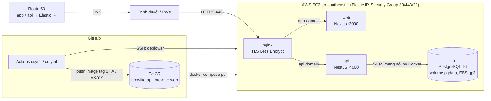

# Triển khai BrewLite lên AWS EC2 (deployment.md)

Tài liệu này mô tả cách triển khai production theo **Task 3.2** của `task1-3-MVP.docx` và **ADR-011** (`011-aws-ec2-platform.md`): **AWS EC2 (VPS, ap-southeast-1)** chạy **Docker Compose**, HTTPS bằng **nginx + Let's Encrypt**, image build ở **GitHub Actions** và lưu ở **GHCR**, triển khai bằng **SSH** từ pipeline CD.

> Bản Render cũ được giữ ở [deployment-render.md](deployment-render.md) để tham khảo, không còn là nền tảng chính thức.
>
> **Quy ước:** `<...>` là giá trị bạn tự điền. Lệnh ghi rõ chạy trên **server** hay **máy local**. Cột "Trạng thái": ✅ đã có trong repo, ⬜ chưa làm.

## 1. URL bàn giao

| Thành phần | URL | Trạng thái |
|---|---|---|
| Frontend (HTTPS) | `https://app.<domain>` | ⬜ |
| API | `https://api.<domain>` | ⬜ |
| Health check | `https://api.<domain>/health` → `{"status":"ok","database":"up",...}` | ⬜ |
| Repository | `https://github.com/quithien22/brewlite-` | ✅ |
| Release | `https://github.com/quithien22/brewlite-/releases/tag/v<X.Y.Z>` | ⬜ |
| Video demo | `<link>` | ⬜ |

Tài khoản demo: `demo@brewlite.vn` / `Demo1234`. Mã khuyến mãi: `CHAO10`, `GIAM15K`, `COMBO20`.

## 2. Kiến trúc triển khai



Điểm chính:

- Hai tên miền: `app.<domain>` (web) và `api.<domain>` (API), cùng trỏ về một Elastic IP. nginx tách theo `server_name`. Trình duyệt gọi API trực tiếp từ origin khác nên API phải bật CORS đúng `FRONTEND_URL`.
- Chỉ nginx publish cổng 80 và 443. `web`, `api`, `db` chỉ nằm trong mạng Docker Compose; cổng 5432 không ra host và Security Group cũng đóng (NFR-14).
- Image **build trong CI, không build trên server**. Server chỉ `pull` rồi `up -d`.
- `NEXT_PUBLIC_API_URL` được nhúng vào bundle web lúc build (build arg trong CI). Đổi domain API thì phải build lại image web.

### Truy vết thành phần → kiến trúc → mã nguồn (khớp bảng Task 3.2)

| Thành phần trong sơ đồ | Thành phần kiến trúc | Mã nguồn / cấu hình | Trạng thái |
|---|---|---|---|
| Container `web` (brewlite-web) | Web App | `apps/web`, `apps/web/Dockerfile` | ✅ |
| Container `api` (brewlite-api) | API + module payments/gateway | `apps/api`, `apps/api/Dockerfile` | ✅ |
| Container `db` (PostgreSQL 16, volume `pgdata` trên EBS) | PostgreSQL | `apps/api/prisma` (schema, migrations, seed) | ✅ |
| nginx (TLS Let's Encrypt) | Điểm vào HTTPS (NFR-14) | `nginx/default.conf.template`, `docker-compose.prod.yml` | ⬜ |
| EC2 + Docker Compose production | Môi trường production | `docker-compose.prod.yml`, `deploy/deploy.sh`, `docs/deployment.md` | ⬜ |
| VPC, Security Group, Elastic IP, Route 53 | Mạng và truy cập | cấu hình AWS, ghi lại ở mục 4 | ⬜ |
| GitHub Actions `ci.yml` / `cd.yml` | CI/CD (NFR-15) | `.github/workflows/` (hiện CI tên `node.js.yml`) | ⬜ |
| GHCR | Kho image (ADR-010) | tag `vX.Y.Z` hoặc `sha-<7 ký tự>` | ⬜ |
| `GET /health` | Module health (NFR-17) | `apps/api/src/health` | ✅ |
| Env / secret | Module config (NFR-07) | `.env` trên EC2 (`chmod 600`), GitHub Secrets | ⬜ |

### Ranh giới môi trường

| Môi trường | Cách chạy |
|---|---|
| Local | `docker compose up --build` (`docker-compose.yml`, cấu hình qua `.env` không commit) |
| CI | PR: cài đặt → lint → test → build, kèm job `e2e` với Postgres tạm |
| Production | EC2 + `docker-compose.prod.yml`; CD chạy khi push tag `v*.*.*` hoặc merge vào `main` |

> `docker-compose.yml` hiện tại **không dùng cho production**: nó publish cổng DB (5433), API (4000), web (3000) và có mật khẩu mặc định.

## 3. Biến môi trường và secret

Chỉ commit `.env.example`. Không commit giá trị thật.

**File `~/brewlite/.env` trên EC2** (`chmod 600`):

| Biến | Dùng cho | Giá trị |
|---|---|---|
| `APP_DOMAIN` | nginx, API (CORS) | `app.<domain>` (không có `https://`) |
| `API_DOMAIN` | nginx, smoke test | `api.<domain>` |
| `POSTGRES_USER`, `POSTGRES_DB` | db, api | `brewlite` |
| `POSTGRES_PASSWORD` | db, api | `openssl rand -hex 24` (hex để không có ký tự đặc biệt làm hỏng `DATABASE_URL`) |
| `JWT_SECRET` | api | `openssl rand -base64 48`; không dùng giá trị mặc định trong repo |
| `JWT_EXPIRES_IN` | api | `7d` hoặc ngắn hơn |
| `ORDER_EXPIRE_MINUTES`, `REFUND_WINDOW_MINUTES` | api | `15`, `5` |
| `MOCK_PAYMENT_ALLOW_FAILURE` | api | `true` nếu cần demo thanh toán lỗi, ngược lại `false` |
| `IMAGE_TAG` | compose | do `deploy.sh` ghi sau mỗi lần deploy thành công |

**GitHub (Settings → Secrets and variables → Actions):**

| Tên | Loại | Dùng cho |
|---|---|---|
| `EC2_HOST` | Secret | Elastic IP hoặc `api.<domain>` |
| `EC2_USER` | Secret | `ubuntu` |
| `EC2_SSH_KEY` | Secret | private key riêng cho CD (không dùng chung key cá nhân) |
| `GITHUB_TOKEN` | có sẵn | push image lên GHCR; server dùng để `docker login` lúc pull |
| `PROD_API_URL` | Variable | `https://api.<domain>` → build arg `NEXT_PUBLIC_API_URL` |
| `PROD_ALLOW_MOCK_FAILURE` | Variable | `true`/`false` → build arg `NEXT_PUBLIC_ALLOW_MOCK_FAILURE`, phải khớp `MOCK_PAYMENT_ALLOW_FAILURE` |

Quy tắc: không `echo` secret trong workflow; không bật `set -x` ở bước dùng secret; `.env` nằm trong `.gitignore` và `.dockerignore`.

## 4. Chuẩn bị hạ tầng AWS

Region **ap-southeast-1 (Singapore)**.

**4.1 Instance**

| Mục | Giá trị |
|---|---|
| AMI | Ubuntu Server 24.04 LTS |
| Loại máy | `t3.small` (2 GB RAM) cho 4 container (nginx, web, api, db). Vì image build ở CI nên server không cần RAM để build, nhưng vẫn nên có swap |
| Storage | EBS **gp3 20 GB** trở lên (chứa image Docker và volume `pgdata`) |
| Key pair | tạo mới, lưu `.pem` an toàn |

**4.2 Security Group (inbound)**

| Cổng | Nguồn | Mục đích |
|---|---|---|
| 80 | `0.0.0.0/0` | chuyển hướng sang HTTPS, Let's Encrypt |
| 443 | `0.0.0.0/0` | web và API |
| 22 | xem lưu ý dưới | quản trị và CD |

Không mở 3000, 4000, 5432.

> **Lưu ý về cổng 22:** docx ghi "22 từ IP của nhóm", nhưng CD cần SSH từ GitHub Actions, mà IP của runner thay đổi liên tục nên bị chặn. Chọn một trong hai cách và sửa docx cho khớp:
> - **(a) Đơn giản:** mở 22 cho `0.0.0.0/0`, chỉ cho đăng nhập bằng key (Ubuntu EC2 mặc định `PasswordAuthentication no`), dùng key riêng cho CD.
> - **(b) Chặt hơn:** giữ 22 cho IP nhóm; trong workflow dùng AWS OIDC role để tạm thêm IP của runner vào Security Group rồi xóa sau khi deploy. Cần thêm bước cấu hình AWS cho GitHub.

**4.3 Elastic IP:** Allocate rồi Associate với instance. Không có Elastic IP thì IP đổi mỗi lần stop/start, DNS và chứng chỉ hỏng.

**4.4 DNS (Route 53):** tạo 2 bản ghi `A`: `app.<domain>` và `api.<domain>` → Elastic IP. Chờ DNS lan truyền (`nslookup app.<domain>`).

Chưa có domain: dùng `app.<ip-gạch>.sslip.io` và `api.<ip-gạch>.sslip.io` (IP `13.212.10.20` → `13-212-10-20`). Dịch vụ dùng chung nên Let's Encrypt có thể giới hạn tần suất cấp chứng chỉ; bản nộp bài nên dùng domain riêng.

**4.5 Chi phí:** AWS tính phí EC2, EBS, snapshot, địa chỉ IPv4 công khai và Route 53. Đặt **AWS Budgets** với cảnh báo email ngay từ đầu (rủi ro "hết credit / phát sinh chi phí" trong docx).

## 5. Chuẩn bị server (làm một lần)

**Chạy trên máy local:**

```bash
chmod 400 brewlite-key.pem
ssh -i brewlite-key.pem ubuntu@<ELASTIC_IP>
```

**Chạy trên server:**

```bash
# 5.1 Cập nhật và cài Docker Engine + Compose plugin
sudo apt-get update && sudo apt-get -y upgrade
curl -fsSL https://get.docker.com | sudo sh
sudo usermod -aG docker ubuntu
exit    # SSH lại để nhóm docker có hiệu lực

# 5.2 Swap 2 GB
sudo fallocate -l 2G /swapfile && sudo chmod 600 /swapfile
sudo mkswap /swapfile && sudo swapon /swapfile
echo '/swapfile none swap sw 0 0' | sudo tee -a /etc/fstab

# 5.3 Thư mục triển khai
mkdir -p ~/brewlite
```

**5.4 Khóa SSH cho CD.** Trên máy local tạo cặp khóa riêng, thêm public key vào server, đặt private key vào GitHub Secret `EC2_SSH_KEY`:

```bash
ssh-keygen -t ed25519 -f brewlite-deploy -N "" -C "brewlite-cd"
# thêm brewlite-deploy.pub vào ~/.ssh/authorized_keys trên server
# dán nội dung file brewlite-deploy (private) vào secret EC2_SSH_KEY, rồi xóa file khỏi máy
```

**5.5 Chứng chỉ Let's Encrypt (lấy trước khi chạy stack, cổng 80 phải đang trống):**

```bash
sudo apt-get install -y certbot
sudo certbot certonly --standalone --cert-name brewlite \
  -d app.<domain> -d api.<domain> -m <email> --agree-tos -n

# Gia hạn dùng chế độ standalone nên cần tạm dừng nginx (chiếm cổng 80) trong lúc gia hạn
sudo tee /etc/letsencrypt/renewal-hooks/pre/stop-nginx.sh >/dev/null <<'EOF'
#!/bin/sh
docker stop brewlite-nginx || true
EOF
sudo tee /etc/letsencrypt/renewal-hooks/post/start-nginx.sh >/dev/null <<'EOF'
#!/bin/sh
docker start brewlite-nginx || true
EOF
sudo chmod +x /etc/letsencrypt/renewal-hooks/pre/stop-nginx.sh /etc/letsencrypt/renewal-hooks/post/start-nginx.sh
sudo certbot renew --dry-run     # phải báo thành công
```

Gói `certbot` của Ubuntu tự cài timer gia hạn (`systemctl list-timers | grep certbot`). Mỗi lần gia hạn nginx dừng vài giây.

**5.6 Tạo `.env`:**

```bash
cat > ~/brewlite/.env <<EOF
APP_DOMAIN=app.<domain>
API_DOMAIN=api.<domain>
POSTGRES_USER=brewlite
POSTGRES_DB=brewlite
POSTGRES_PASSWORD=$(openssl rand -hex 24)
JWT_SECRET=$(openssl rand -base64 48 | tr -d '\n')
JWT_EXPIRES_IN=7d
ORDER_EXPIRE_MINUTES=15
REFUND_WINDOW_MINUTES=5
MOCK_PAYMENT_ALLOW_FAILURE=false
EOF
chmod 600 ~/brewlite/.env
```

## 6. Tệp cấu hình trong repo (cần tạo và commit ⬜)

**`docker-compose.prod.yml`** (gốc repo):

```yaml
x-logging: &logging
  driver: json-file
  options:
    max-size: "10m"
    max-file: "3"

services:
  db:
    image: postgres:16-alpine
    restart: unless-stopped
    logging: *logging
    environment:
      POSTGRES_USER: ${POSTGRES_USER:-brewlite}
      POSTGRES_PASSWORD: ${POSTGRES_PASSWORD:?thiếu POSTGRES_PASSWORD}
      POSTGRES_DB: ${POSTGRES_DB:-brewlite}
    volumes:
      - pgdata:/var/lib/postgresql/data
    healthcheck:
      test: ["CMD-SHELL", "pg_isready -U ${POSTGRES_USER:-brewlite} -d ${POSTGRES_DB:-brewlite}"]
      interval: 5s
      timeout: 5s
      retries: 10
    # không publish cổng 5432

  api:
    image: ghcr.io/quithien22/brewlite-api:${IMAGE_TAG:?thiếu IMAGE_TAG}
    restart: unless-stopped
    logging: *logging
    depends_on:
      db:
        condition: service_healthy
    environment:
      DATABASE_URL: postgresql://${POSTGRES_USER:-brewlite}:${POSTGRES_PASSWORD}@db:5432/${POSTGRES_DB:-brewlite}?schema=public
      JWT_SECRET: ${JWT_SECRET:?thiếu JWT_SECRET}
      JWT_EXPIRES_IN: ${JWT_EXPIRES_IN:-7d}
      PORT: "4000"
      FRONTEND_URL: https://${APP_DOMAIN:?thiếu APP_DOMAIN}
      ORDER_EXPIRE_MINUTES: ${ORDER_EXPIRE_MINUTES:-15}
      REFUND_WINDOW_MINUTES: ${REFUND_WINDOW_MINUTES:-5}
      MOCK_PAYMENT_ALLOW_FAILURE: ${MOCK_PAYMENT_ALLOW_FAILURE:-false}
    expose:
      - "4000"

  web:
    image: ghcr.io/quithien22/brewlite-web:${IMAGE_TAG:?thiếu IMAGE_TAG}
    restart: unless-stopped
    logging: *logging
    depends_on:
      - api
    expose:
      - "3000"

  nginx:
    image: nginx:1.27-alpine
    container_name: brewlite-nginx
    restart: unless-stopped
    logging: *logging
    depends_on:
      - api
      - web
    environment:
      APP_DOMAIN: ${APP_DOMAIN}
      API_DOMAIN: ${API_DOMAIN}
      # chỉ thay APP_DOMAIN và API_DOMAIN, giữ nguyên $host, $request_uri...
      NGINX_ENVSUBST_FILTER: "^(APP|API)_DOMAIN$$"
    ports:
      - "80:80"
      - "443:443"
    volumes:
      - ./nginx/default.conf.template:/etc/nginx/templates/default.conf.template:ro
      - /etc/letsencrypt:/etc/letsencrypt:ro

volumes:
  pgdata:
```

**`nginx/default.conf.template`**:

```nginx
# Phân giải tên qua DNS của Docker để nginx không giữ IP cũ khi container api/web được tạo lại
resolver 127.0.0.11 valid=10s;

server {
    listen 80;
    server_name ${APP_DOMAIN} ${API_DOMAIN};
    return 301 https://$host$request_uri;
}

server {
    listen 443 ssl;
    http2 on;
    server_name ${APP_DOMAIN};

    ssl_certificate     /etc/letsencrypt/live/brewlite/fullchain.pem;
    ssl_certificate_key /etc/letsencrypt/live/brewlite/privkey.pem;
    ssl_protocols TLSv1.2 TLSv1.3;
    add_header Strict-Transport-Security "max-age=31536000" always;

    location / {
        set $web http://web:3000;
        proxy_pass $web;
        proxy_set_header Host $host;
        proxy_set_header X-Real-IP $remote_addr;
        proxy_set_header X-Forwarded-For $proxy_add_x_forwarded_for;
        proxy_set_header X-Forwarded-Proto $scheme;
    }
}

server {
    listen 443 ssl;
    http2 on;
    server_name ${API_DOMAIN};

    ssl_certificate     /etc/letsencrypt/live/brewlite/fullchain.pem;
    ssl_certificate_key /etc/letsencrypt/live/brewlite/privkey.pem;
    ssl_protocols TLSv1.2 TLSv1.3;
    add_header Strict-Transport-Security "max-age=31536000" always;

    client_max_body_size 1m;

    location / {
        set $api http://api:4000;
        proxy_pass $api;
        proxy_set_header Host $host;
        proxy_set_header X-Real-IP $remote_addr;
        proxy_set_header X-Forwarded-For $proxy_add_x_forwarded_for;
        proxy_set_header X-Forwarded-Proto $scheme;
    }
}
```

**`deploy/deploy.sh`** (CD copy lên server và chạy; cũng dùng để rollback bằng tay):

```bash
#!/usr/bin/env bash
# Dùng: ./deploy.sh <image-tag>     ví dụ: ./deploy.sh v1.0.1  hoặc  ./deploy.sh sha-1a2b3c4
# Tag được ghi vào .env CHỈ khi smoke test đạt, nên .env luôn giữ tag tốt gần nhất.
set -euo pipefail
cd "$(dirname "$0")"

NEW_TAG="${1:?usage: deploy.sh <image-tag>}"
COMPOSE="docker compose -f docker-compose.prod.yml"
PREV_TAG="$(grep -E '^IMAGE_TAG=' .env | cut -d= -f2 || true)"
API_DOMAIN="$(grep -E '^API_DOMAIN=' .env | cut -d= -f2)"

set_tag() {
  if grep -q '^IMAGE_TAG=' .env; then sed -i "s|^IMAGE_TAG=.*|IMAGE_TAG=$1|" .env
  else echo "IMAGE_TAG=$1" >> .env; fi
}

smoke() {
  for _ in $(seq 1 30); do
    if curl -fsS "https://${API_DOMAIN}/health" >/dev/null \
       && curl -fsS "https://${API_DOMAIN}/products" >/dev/null; then
      return 0
    fi
    sleep 4
  done
  return 1
}

export IMAGE_TAG="$NEW_TAG"
$COMPOSE pull
$COMPOSE up -d --remove-orphans

if smoke; then
  set_tag "$NEW_TAG"
  echo "Deploy $NEW_TAG thành công"
  exit 0
fi

echo "Smoke test thất bại với $NEW_TAG" >&2
$COMPOSE logs --tail=50 api >&2 || true
if [ -n "$PREV_TAG" ] && [ "$PREV_TAG" != "$NEW_TAG" ]; then
  echo "Rollback về $PREV_TAG" >&2
  export IMAGE_TAG="$PREV_TAG"
  $COMPOSE up -d --remove-orphans
  smoke && echo "Đã rollback về $PREV_TAG" >&2 || echo "Rollback xong nhưng smoke test vẫn lỗi, cần kiểm tra thủ công" >&2
fi
exit 1
```

Script rollback ứng dụng (đổi `IMAGE_TAG` về tag trước), không rollback database (xem mục 10).

## 7. Pipeline CI/CD

### CI (`ci.yml`)
Hiện là `.github/workflows/node.js.yml` ✅ (api, web, e2e; chạy ở PR và push `main`). Nên đổi tên thành `ci.yml` cho khớp docx và đặt `api`, `web`, `e2e` làm required status check trong branch protection của `main` ⬜.

### CD (`.github/workflows/cd.yml` ⬜)
Chạy khi push tag `v*.*.*` hoặc merge vào `main`:

```
quality (lint, test, build) → build & push GHCR → SSH vào EC2 chạy deploy.sh (pull, up -d, smoke test, tự rollback)
```

```yaml
name: CD

on:
  push:
    branches: [main]
    tags: ["v*.*.*"]
  workflow_dispatch:

concurrency:
  group: cd-production
  cancel-in-progress: false

permissions:
  contents: read
  packages: write

env:
  IMAGE_API: ghcr.io/quithien22/brewlite-api
  IMAGE_WEB: ghcr.io/quithien22/brewlite-web

jobs:
  quality:
    runs-on: ubuntu-latest
    steps:
      - uses: actions/checkout@v4
      - uses: actions/setup-node@v4
        with:
          node-version: 22.x
      - name: API
        working-directory: apps/api
        run: |
          npm ci
          npx prisma generate
          npm test
          npm run build
      - name: Web
        working-directory: apps/web
        run: |
          npm ci
          npm run lint
          npm run build

  build:
    needs: quality
    runs-on: ubuntu-latest
    outputs:
      tag: ${{ steps.tag.outputs.tag }}
    steps:
      - uses: actions/checkout@v4
      - id: tag
        run: |
          if [[ "$GITHUB_REF" == refs/tags/* ]]; then
            echo "tag=${GITHUB_REF_NAME}" >> "$GITHUB_OUTPUT"
          else
            echo "tag=sha-${GITHUB_SHA::7}" >> "$GITHUB_OUTPUT"
          fi
      - uses: docker/login-action@v3
        with:
          registry: ghcr.io
          username: ${{ github.actor }}
          password: ${{ secrets.GITHUB_TOKEN }}
      - name: Build và push API
        uses: docker/build-push-action@v6
        with:
          context: apps/api
          push: true
          tags: ${{ env.IMAGE_API }}:${{ steps.tag.outputs.tag }}
          labels: org.opencontainers.image.source=https://github.com/${{ github.repository }}
      - name: Build và push Web
        uses: docker/build-push-action@v6
        with:
          context: apps/web
          push: true
          tags: ${{ env.IMAGE_WEB }}:${{ steps.tag.outputs.tag }}
          labels: org.opencontainers.image.source=https://github.com/${{ github.repository }}
          build-args: |
            NEXT_PUBLIC_API_URL=${{ vars.PROD_API_URL }}
            NEXT_PUBLIC_ALLOW_MOCK_FAILURE=${{ vars.PROD_ALLOW_MOCK_FAILURE }}

  deploy:
    needs: build
    runs-on: ubuntu-latest
    environment: production
    env:
      EC2_HOST: ${{ secrets.EC2_HOST }}
      EC2_USER: ${{ secrets.EC2_USER }}
      IMAGE_TAG: ${{ needs.build.outputs.tag }}
      GH_ACTOR: ${{ github.actor }}
      GH_TOKEN: ${{ secrets.GITHUB_TOKEN }}
    steps:
      - uses: actions/checkout@v4
      - name: Cấu hình SSH
        env:
          EC2_SSH_KEY: ${{ secrets.EC2_SSH_KEY }}
        run: |
          install -m 700 -d ~/.ssh
          printf '%s\n' "$EC2_SSH_KEY" > ~/.ssh/id_ed25519
          chmod 600 ~/.ssh/id_ed25519
          ssh-keyscan -H "$EC2_HOST" >> ~/.ssh/known_hosts
      - name: Gửi cấu hình lên server
        run: |
          scp -r docker-compose.prod.yml nginx deploy/deploy.sh "$EC2_USER@$EC2_HOST:brewlite/"
      - name: Đăng nhập GHCR trên server
        run: |
          printf '%s' "$GH_TOKEN" | ssh "$EC2_USER@$EC2_HOST" \
            "docker login ghcr.io -u '$GH_ACTOR' --password-stdin"
      - name: Deploy, smoke test, tự rollback nếu lỗi
        run: |
          ssh "$EC2_USER@$EC2_HOST" "chmod +x ~/brewlite/deploy.sh && ~/brewlite/deploy.sh '$IMAGE_TAG'"
```

Ghi chú:
- `deploy.sh` thoát mã khác 0 khi smoke test lỗi, nên job đỏ và pipeline dừng; server đã tự quay về tag trước.
- `ssh-keyscan` tin host key ở lần kết nối đầu của mỗi lần chạy. Muốn chặt hơn, lưu host key của EC2 vào một secret và ghi vào `known_hosts` thay vì quét.
- Không dùng `:latest` làm nguồn rollback; chỉ dùng tag bất biến `vX.Y.Z` hoặc `sha-...`.
- Workflow cũ `nextjs.yml` (GitHub Pages) không còn phù hợp vì web chạy trong container. Xóa file này và nhánh `production` nếu không cần ⬜.

## 8. Triển khai lần đầu

1. Hoàn tất mục 4 (AWS) và mục 5 (server, khóa SSH, chứng chỉ, `.env`).
2. Đặt Secrets/Variables ở mục 3 trên GitHub; tạo environment `production`.
3. Commit `docker-compose.prod.yml`, `nginx/default.conf.template`, `deploy/deploy.sh`, `cd.yml` vào `main`.
4. Mở tab Actions, theo dõi workflow CD. Hoặc tạo release: `git tag v1.0.0 && git push origin v1.0.0`.
5. Lần chạy đầu `deploy.sh` không có `PREV_TAG`, nên nếu smoke test lỗi sẽ không có gì để rollback; xem log bằng mục 12.
6. Kiểm tra theo mục 9.

Khi khởi động, container `api` tự chạy `prisma migrate deploy` (chỉ áp dụng migration đã có), rồi `prisma db seed` (idempotent), rồi chạy API (xem `apps/api/Dockerfile`).

## 9. Kiểm tra sau triển khai

**Máy local:**

```bash
curl -fsS https://api.<domain>/health          # 200, "database":"up"
curl -fsS https://api.<domain>/products | head
API_URL=https://api.<domain> node tests/e2e/smoke.mjs
curl -I http://app.<domain>                    # 301 sang https
nc -zv -w 5 <ELASTIC_IP> 5432                  # phải thất bại
nc -zv -w 5 <ELASTIC_IP> 4000                  # phải thất bại
nc -zv -w 5 <ELASTIC_IP> 3000                  # phải thất bại
```

Trình duyệt: mở `https://app.<domain>` (ổ khóa hợp lệ) → xem menu → đăng nhập tài khoản demo → đặt đơn → thanh toán → thấy màn hình xác nhận và đơn `PAID` trong lịch sử. Mở DevTools, không có lỗi CORS khi gọi `api.<domain>`.

Log không được chứa `JWT_SECRET`, mật khẩu DB hay token:
`docker compose -f docker-compose.prod.yml logs | grep -i -E "secret|password"`.

## 10. Rollback

**Ứng dụng (api, web):** image tag bất biến nên chỉ cần deploy lại tag cũ. Hai cách:

- **Tự động:** `deploy.sh` tự quay về tag trước khi smoke test lỗi (xem mục 7).
- **Thủ công**, trên server:
  ```bash
  cd ~/brewlite
  docker images | grep brewlite               # xem các tag còn trên server
  ./deploy.sh v1.0.0                          # hoặc sha-1a2b3c4; tag cũ được pull lại từ GHCR nếu đã bị dọn
  ```
  Hoặc chạy lại workflow CD cho commit/tag cũ.

**Database:** Prisma migration chỉ đi tới, không có "down". Vì vậy:

- Viết migration tương thích ngược (thêm cột/bảng; không xóa hoặc đổi tên cột trong cùng release với code dùng nó).
- Backup trước mọi release có migration (mục 11).
- Chỉ khi migration làm hỏng dữ liệu mới khôi phục (mất thay đổi sau thời điểm backup):
  ```bash
  cd ~/brewlite
  docker compose -f docker-compose.prod.yml stop api
  docker compose -f docker-compose.prod.yml exec -T db \
    pg_restore --clean --if-exists -U brewlite -d brewlite < ~/backups/<file>.dump
  docker compose -f docker-compose.prod.yml start api
  ```
- Không dùng `prisma db push` hay `migrate reset` trên production.

**Cấu hình sai:** sửa `~/brewlite/.env` rồi `docker compose -f docker-compose.prod.yml up -d`. Riêng `NEXT_PUBLIC_*` phải sửa Variable trên GitHub và build lại image web.

## 11. Backup

Dữ liệu nằm ở volume `pgdata` trên EBS. Dùng hai lớp theo rủi ro "mất dữ liệu" trong docx:

**11.1 `pg_dump` định kỳ.** Tạo `~/backup.sh` trên server:

```bash
#!/usr/bin/env bash
set -euo pipefail
cd ~/brewlite
mkdir -p ~/backups
FILE=~/backups/brewlite-$(date +%F-%H%M).dump
docker compose -f docker-compose.prod.yml exec -T db \
  pg_dump -U brewlite -Fc brewlite > "$FILE"
find ~/backups -name 'brewlite-*.dump' -mtime +7 -delete
```

```bash
chmod +x ~/backup.sh
(crontab -l 2>/dev/null; echo '0 3 * * * /home/ubuntu/backup.sh >> /home/ubuntu/backup.log 2>&1') | crontab -
```

**11.2 Snapshot EBS.** Bật **Amazon Data Lifecycle Manager** (EC2 → Lifecycle Manager) tạo snapshot hằng ngày cho volume gốc, giữ 7 bản. Snapshot nằm ngoài instance nên chống được mất instance; file `pg_dump` thì nằm cùng ổ đĩa nên nên chép thêm ra ngoài (ví dụ S3 bucket riêng tư qua IAM role) nếu cần.

Thử khôi phục từ backup ít nhất một lần trước khi bàn giao.

## 12. Vận hành

| Việc | Lệnh (trong `~/brewlite`) |
|---|---|
| Trạng thái | `docker compose -f docker-compose.prod.yml ps` |
| Log API | `docker compose -f docker-compose.prod.yml logs -f --tail=100 api` |
| Log nginx | `docker compose -f docker-compose.prod.yml logs --tail=100 nginx` |
| Khởi động lại một dịch vụ | `docker compose -f docker-compose.prod.yml restart api` |
| Dọn image cũ không dùng | `docker image prune -af --filter "until=720h"` |
| Dung lượng | `df -h` và `docker system df` |

- Log giới hạn 10 MB × 3 file mỗi container (cấu hình `x-logging`). API ghi stdout: method, đường dẫn, status, thời gian; không ghi header hay body.
- Sau khi instance reboot, container tự chạy lại nhờ `restart: unless-stopped`.
- Cập nhật hệ điều hành định kỳ: `sudo apt-get update && sudo apt-get -y upgrade`; có thể bật `unattended-upgrades`.
- `CMD` của API chạy `prisma db seed` mỗi lần khởi động và tạo tài khoản demo có mật khẩu công khai. Chấp nhận cho môi trường chấm điểm; nếu chạy thật thì tắt phần seed tài khoản demo.

## 13. Sự cố thường gặp

| Triệu chứng | Nguyên nhân thường gặp | Cách xử lý |
|---|---|---|
| nginx không lên, log báo thiếu `/etc/letsencrypt/live/brewlite/...` | chưa lấy chứng chỉ, hoặc `--cert-name` khác `brewlite` | làm lại mục 5.5 |
| `certbot` báo lỗi cổng 80 | nginx đang chạy | dừng `brewlite-nginx` rồi chạy lại, hoặc kiểm tra hook ở mục 5.5 |
| Chứng chỉ không cấp được | DNS chưa trỏ về Elastic IP, Security Group chưa mở 80 | `nslookup`, kiểm tra Security Group |
| Web lên nhưng gọi `localhost:4000` hoặc sai API | image web build với `NEXT_PUBLIC_API_URL` sai/cũ | sửa Variable `PROD_API_URL`, chạy lại CD |
| Lỗi CORS | `APP_DOMAIN` trong `.env` không khớp origin đang dùng | sửa `.env`, `up -d`; nhiều origin thì ngăn cách bằng dấu phẩy trong `FRONTEND_URL` |
| 502 từ nginx sau khi deploy | `api` chưa sẵn sàng hoặc migration lỗi | `logs api`; `deploy.sh` sẽ tự rollback nếu smoke test lỗi |
| `api` restart liên tục | sai `DATABASE_URL`/mật khẩu | đã đổi `POSTGRES_PASSWORD` trong `.env` sau lần chạy đầu, nhưng volume `pgdata` vẫn giữ mật khẩu cũ; đặt lại đúng mật khẩu cũ hoặc đổi bằng `ALTER USER` |
| `pull access denied` | server chưa `docker login ghcr.io` hoặc package chưa gắn với repo | chạy lại CD (bước đăng nhập GHCR); kiểm tra nhãn `org.opencontainers.image.source` |
| CD lỗi ở bước SSH | Security Group chặn cổng 22 từ runner, sai key | xem lưu ý cổng 22 ở mục 4.2 |
| Hết dung lượng đĩa | image cũ | `docker image prune -af --filter "until=720h"` |

## 14. Đồng bộ với tài liệu MVP và repo

Việc cần làm để repo khớp `task1-3-MVP.docx`:

- ⬜ Đổi `docs/architecture/adr/011-render-platform.md` thành `011-aws-ec2-platform.md` (quyết định EC2, phương án Render đã cân nhắc, rủi ro chi phí và vận hành).
- ⬜ Tạo `docker-compose.prod.yml`, `nginx/default.conf.template`, `deploy/deploy.sh`, `.github/workflows/cd.yml` (mục 6, 7).
- ⬜ Đổi `node.js.yml` thành `ci.yml`; xóa `nextjs.yml` nếu bỏ GitHub Pages.
- ⬜ Vẽ UML deployment `docs/diagrams/deployment-production.puml` + `.svg` (Hình 3.4) khớp mục 2.
- ⬜ Quyết định cổng 22 (mục 4.2) và sửa câu "22 từ IP của nhóm" trong docx nếu chọn cách (a).
- ⬜ Docx ghi cổng DB local `5432`, còn `docker-compose.yml` hiện dùng `5433` ở host; sửa một trong hai cho khớp.

## 15. Checklist bàn giao

- [ ] `https://app.<domain>` mở được qua HTTPS (chứng chỉ hợp lệ)
- [ ] `https://api.<domain>/health` trả 200 với `"database":"up"`
- [ ] Security Group: Internet chỉ vào 80/443; 3000, 4000, 5432 không truy cập được từ ngoài
- [ ] Instance dùng Elastic IP; Route 53 trỏ đúng
- [ ] `JWT_SECRET`, `POSTGRES_PASSWORD` production là giá trị ngẫu nhiên; `.env` không nằm trong Git
- [ ] Quét secret toàn lịch sử Git sạch (`gitleaks detect --source . --log-opts="--all"`)
- [ ] Pipeline CD chạy thành công một lần, kèm một lần smoke test thất bại tự rollback làm minh chứng
- [ ] Gia hạn chứng chỉ thử thành công (`certbot renew --dry-run`)
- [ ] Backup `pg_dump` và snapshot EBS chạy; đã thử khôi phục một lần
- [ ] AWS Budgets có cảnh báo chi phí
- [ ] Tag `vX.Y.Z` và release notes trên GitHub
- [ ] UML deployment trong `docs/diagrams/` khớp tài liệu này
- [ ] README trỏ về tài liệu này (local, test, build, deploy, rollback)
- [ ] Video demo luồng end-to-end
- [ ] Giảng viên có quyền truy cập repository
